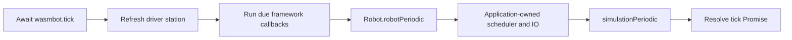

# Wasmbot

`wasmbot` builds ordinary FRC WPILib Commands V3 robot programs with GraalVM Web Image. The runtime package is **`org.teamvan.wasmbot`**. The same `Robot` class and its `robotPeriodic()` method run on desktop/hardware and under WASM; there is no separate simulation lifecycle adapter.

The plugin owns the runtime/shadows, JSPI continuation engine, native build configuration, generic browser telemetry viewer, and native smoke suite. It contains no project-specific drivetrain acceptance tests or Pose-channel assumptions. Struct/protobuf publishing retains its existing hex wire format.

## LLM usage

LLMs were used to generate code for this project. All generated output was reviewed and tested.

## Requirements

- Gradle 9.4.1, Java 25, and WPILib 2027 alpha-7 with its Commands V3 vendordep are the supported baseline.
- A GraalVM JDK containing Web Image (`native-image --tool:svm-wasm` and `org.graalvm.webimage.api`). A normal Java 25 JDK alone cannot compile the WASM runtime.
- Binaryen on `PATH` and a GraalVM-supported native compiler.
- A JSPI-capable JavaScript runtime for CLI smokes, and a JSPI-capable browser for the viewer: both `WebAssembly.Suspending` and `WebAssembly.promising` must exist. Bun is the default CLI runtime.

On Windows, use a **VS Code x64 developer terminal**. For the Downloads JDK used here:

```powershell
$env:JAVA_HOME = Join-Path $env:USERPROFILE 'Downloads\graalvm-25.4.4.1.1+1.1'
$env:GRAALVM_HOME = $env:JAVA_HOME
$env:Path = "$env:JAVA_HOME\bin;$env:Path"
java -version
$env:VSCMD_ARG_HOST_ARCH
$env:VSCMD_ARG_TGT_ARCH
```

Both architecture values must be `x64`. Adjust the JDK path for another installation, and ensure Gradle's JVM/toolchain configuration does not select a different compiler. Keep the consumer's ordinary WPILib and vendor Java dependencies, including Commands V3; Commands V2 and V3 cannot coexist.

## Install the plugin

### Included source build

Put this standalone build at `wasmbot/` inside the robot project, or use a corresponding relative path. Add the following **inside the consumer's existing `pluginManagement` block** in `settings.gradle`:

```groovy
includeBuild('wasmbot')
```

Keep the normal generated WPILib repository configuration. Add this entry to the consumer's existing `plugins` block:

```groovy
id 'org.teamvan.wasmbot'
```

The plugin JAR bundles runtime Java sources, metadata, browser assets, tools, and smoke sources. Each consumer compiles the runtime against its own WPILib dependency classpath. The included build tracks source and resource changes automatically.

### Published artifact

Add `mavenCentral()` to the consumer's existing `pluginManagement.repositories` in `settings.gradle`, keeping its WPILib and Gradle Plugin Portal repositories. Then apply the published version in `build.gradle`:

```groovy
id 'org.teamvan.wasmbot' version '0.1.0'
```

The implementation coordinate is `org.teamvan.wasmbot:wasmbot:0.1.0`, resolved through the `org.teamvan.wasmbot` Gradle plugin marker. Both are published to Maven Central, not the Gradle Plugin Portal. The plugin ID replaces the old unqualified `wasmbot` ID; the `wasmbot { ... }` extension and runtime packages are unchanged.

For local development, run `gradle check assemble publishToMavenLocal` from this standalone build with Gradle 9.4.1 and Java 25, then add `mavenLocal()` before `mavenCentral()` in the consumer's `pluginManagement.repositories`. The [independent example](examples/commands-v3) uses this published-plugin path, not an included source build.

Do not add the core runtime as a desktop `implementation` dependency. The plugin adds it only to the WASM source sets.

## Start your normal Robot

Use the same entry-point pattern as ordinary WPILib:

```java
package example;

import org.wpilib.framework.RobotBase;

public final class Main {
  private Main() {}

  public static void main(String... args) {
    RobotBase.startRobot(Robot::new);
  }
}
```

The [example Main](examples/commands-v3/src/main/java/example/Main.java) is used directly for both targets. You can instead keep a tiny `WasmMain` in `src/wasm/java/` with the same `RobotBase.startRobot(Robot::new)` call, if your project wants separate entry-point names. It must not duplicate mechanism construction, input/output loops, or scheduler execution.

Configure that actual class in the consumer:

```groovy
wasmbot {
    mainClass.set('example.Main')
    imageName.set('counter')
}
```

| Property            | Default  | Meaning                                                            |
| ------------------- | -------- | ------------------------------------------------------------------ |
| `mainClass`         | Required | Ordinary entry point calling `RobotBase.startRobot(Robot::new)`.   |
| `imageName`         | `wasm`   | Native artifact basename, without extensions.                      |
| `javascriptRuntime` | `bun`    | JSPI-capable executable on `PATH`, or an absolute executable path. |

The plugin applies the native-build plugin itself. Remove obsolete local WASM adapters, copied runtime sources, native binary definitions, and loader-patching scripts when migrating. The public extension is `wasmbot`.

## Robot lifecycle and the command scheduler

The host installs the runtime and invokes `wasmbot.start()`. Wasmbot installs its telemetry backend, refreshes driver-station data, constructs the real `Robot` once, and starts a nonblocking framework lifecycle. For the 2027 SDK, initialization belongs in the constructor; `simulationInit()` follows exactly once.



`robotPeriodic()` runs in both enabled and disabled cycles. **Wasmbot does not call `Scheduler.run()` for you.** Keep the existing scheduler call inside your normal robot method; it must run only once per intended robot cycle. For example, the [shared example Robot](examples/commands-v3/src/main/java/example/Robot.java) uses:

```java
@Override
public void robotPeriodic() {
  Scheduler.getDefault().run();
  Telemetry.log("Example/Counter", counter.ticks());
  directCounter.set(counter.ticks());
  Telemetry.log("Example/Enabled", RobotState.isEnabled());
  Telemetry.log("Example/Wasmbot", Boolean.getBoolean("wasmbot"));
}
```

Input sampling and output publication should likewise stay in this shared robot lifecycle, in the order appropriate for the project. Commands V3's scheduler does not implicitly filter its entire run loop by enable state; the enabled/disabled policy above is ordinary application code, not a WASM-specific branch.

`Scheduler` and `Coroutine` remain the real WPILib classes. JSPI-backed continuation shadows preserve suspended Java stacks, command-local variables, child awaiting, cancellation, and exception identity.

### Supported framework behavior

- `OpModeRobot` and `TimedRobot`/`IterativeRobotBase` use HAL-free, host-driven lifecycle implementations. No HAL notifier, native scheduler thread, or blocking competition loop is started.
- Construction and `simulationInit()` happen once. Driver-station connection callbacks, disabled transitions, periodic hooks, and `simulationPeriodic()` follow the SDK ordering. Exceptions propagate; failed expirations are not replayed at the same host time.
- Configured main-loop periods and `addPeriodic(...)` callbacks use the host's monotonic clock. Only due callbacks execute. A period shorter than the host interval is quantized to that interval; missed expirations coalesce instead of replaying a burst.
- `endCompetition()`/`close()` stop subsequent callbacks. `getLoopStartTime()` uses the host clock.
- The current driver station has **no selected opmode**. `OpModeRobot.nonePeriodic()` runs, while automatic classpath/JAR discovery and explicit opmode registration/selection are not available. They are not replaced with fake selected modes. With the SDK's UNKNOWN mode, iterative frameworks use disabled-mode callbacks even if the enable bit is set; `robotPeriodic()` still runs.
- Native watchdog diagnostics and physical HID outputs are unavailable and fail explicitly if invoked. A custom blocking `RobotBase` subclass needs a host-driven WASM implementation rather than a native loop.

Choose simulated IO using your existing `RobotBase.isSimulation()`/`isReal()` selection. These shadows do not emulate every vendor or HAL API. Avoid hardware/JNI initialization in static fields that run before your simulation selection.

## Detect WASM without a dependency

Use **standard Java**, anywhere in shared robot code:

```java
boolean runningUnderWasm = Boolean.getBoolean("wasmbot");
```

Wasmbot sets the `wasmbot` system property to `true` **before invoking the Robot constructor**. It is unset—and `Boolean.getBoolean` returns `false`—in ordinary desktop/hardware launches unless explicitly overridden by the user.

A project can expose a normal Java helper without importing any Wasmbot class:

```java
public static boolean isWasm() {
  return Boolean.getBoolean("wasmbot");
}
```

The consuming robot's `Constants.isWasm()` follows this pattern. Prefer reading through a method rather than caching a build-time-initialized flag. Do not import `org.teamvan.wasmbot.*` into shared `src/main/java/` just to detect the environment: a conditional around such references would still require those classes at Java compile time. Neither the entry point nor the detection method needs that dependency.

## Build, smoke, and serve

From the consuming robot project:

```sh
./gradlew nativeCompile
./gradlew wasmRun
./gradlew wasmSmoke
./gradlew wasmSite
python -m http.server 8099 --directory build/wasm/site
```

Open `http://localhost:8099/sim/`. On Windows, `.\gradlew.bat` is equivalent to `./gradlew`.

| Task                 | Result                                                                                                                                                                                                                          |
| -------------------- | ------------------------------------------------------------------------------------------------------------------------------------------------------------------------------------------------------------------------------- |
| `nativeCompile`      | `build/native/nativeCompile/<imageName>.js` and `<imageName>.js.wasm`.                                                                                                                                                          |
| `wasmRun`            | Starts the consumer's actual Robot, advances disabled/enabled ticks, and reports telemetry count and tick latency.                                                                                                              |
| `nativeSmokeCompile` | Builds the library's native behavioral smoke image.                                                                                                                                                                             |
| `wasmSmoke`          | Exercises RobotBase startup, constructor detection, lifecycle order/cadence/stop, scheduler execution counts, dynamics, serialization, continuations, cancellation, child awaiting, exceptions, and overlapping-tick rejection. |
| `wasmSite`           | Stages the complete generic browser frontend at `build/wasm/site/sim/`.                                                                                                                                                         |

The staged browser assets always use canonical `wasm.js`/`wasm.js.wasm` names, even for a native image named `counter`. Serve the staged directory over HTTP, not `file://`.

The browser begins disabled. Enable it with the checkbox. It displays all telemetry topics without assuming a drivetrain or a Pose format. W/S change left Y, A/D left X, Q/E right X, and Shift chooses red alliance. Text is rendered as text, not executable HTML.

The low-level tools in `build/wasm/library/tools/wasm-debug/` accept:

```text
run-wasm.mjs [buildDir] [imageName]
run-smoke.mjs [buildDir] [imageName]
run-browser.mjs [pageUrl] [debugPort]
```

Run them with the configured JSPI-capable Node/Bun executable. Paths default from the consumer's current working directory. Prefer the Gradle tasks to keep image names and artifact paths synchronized.

### Independent published-plugin example

From this repository's root:

```sh
./gradlew -p wasmbot check assemble publishToMavenLocal
./gradlew -p wasmbot/examples/commands-v3 wasmRun wasmSmoke wasmSite
python -m http.server 8099 --directory wasmbot/examples/commands-v3/build/wasm/site
```

That example uses a normal `Main` and `Robot`, a real scheduler-driven counter, a different image name, and no core imports in shared Java. The viewer shows `/Example/Counter`, `/Example/DirectCounter`, `/Example/Enabled`, and `/Example/Wasmbot`. `DirectCounter` uses a cached WPILib `DoublePublisher`, not `Telemetry`:

```java
private final DoublePublisher directCounter = NetworkTableInstance.getDefault()
    .getDoubleTopic("/Example/DirectCounter").publish();
```

The WASM NetworkTables Java surface currently supports default-instance typed double publishers with no publisher options: `publish()`, `set(value)`, `set(value, timestampNanos)`, `setDefault(value)`, and `close()`/`unpublish()`. Other Java NT types, subscriptions, listeners, instance creation, and network client/server startup are not supported. Desktop/hardware builds still use the ordinary SDK implementation.

## JavaScript host and telemetry

All project-owned JavaScript hooks and exports live on the single global object `globalThis.wasmbot`; there are no standalone global aliases. GraalVM's `GraalVM` global and the browser's `document` remain unchanged. For a custom frontend, initialize the clock, driver-station hook, and JSPI continuation engine on this object **before** installing NetworkTables or importing the image, and therefore before `GraalVM.run()`:

```js
import { createWasmContinuations } from "./sim/continuations.js";
import { createNetworkTables } from "./sim/networktables.js";

let nowNanos = 0;
const ds = { enabled: false, alliance: "blue", leftX: 0, leftY: 0, rightX: 0 };
globalThis.wasmbot = {
  nowNanos: () => nowNanos,
  driverStation: () => ds,
  continuations: createWasmContinuations(),
};
const networkTables = createNetworkTables(globalThis.wasmbot.nowNanos);
networkTables.install(); // adds nt, ntGet, and ntPut to globalThis.wasmbot
```

| Field on `globalThis.wasmbot` | Contract |
| ---------------------------- | -------- |
| `nowNanos()` | Monotonic simulated time, in nanoseconds. |
| `driverStation()` | `{enabled, alliance, leftX, leftY, rightX}`; alliance is `"red"` or `"blue"`, axes are in `[-1, 1]`. |
| `ntGet(path)` | Current host value, or `undefined` if no value exists. |
| `ntPut(path, value, type?, timestampUs?)` | Publishes a JavaScript value; type defaults to inference and timestamp to the host clock. |
| `nt` | Shared in-process topic transport installed by `networkTables.install()`. |
| `continuations` | JSPI engine returned by `createWasmContinuations()`, installed by the host before the image runs. |
| `start()` | Export installed by the image; starts the real Robot once, without resetting it on repeated calls. |
| `tick()` | Export installed by the image; returns a Promise for one framework tick. |
| `probe` | Smoke-image fixture exports, used by the native smoke harness. |

After importing the image and awaiting `GraalVM.run()`, call `wasmbot.start()`. Advance the host clock by 20 ms per default tick and **await the `wasmbot.tick()` Promise before starting another tick**. The supplied viewer serializes ticks and reports startup/runtime failures. JSPI requires neither `SharedArrayBuffer` nor cross-origin isolation.

Telemetry values retain their existing format: primitive scalars and arrays are native JS values; raw bytes, little-endian structs, and protobuf wire bytes are lowercase hex strings. Longs outside JS's safe-integer range are exact decimal strings, including in arrays. The host infers types for untyped telemetry values (numbers are `double`, empty arrays are `double[]`); telemetry's original type strings, properties, and log timestamps are not transported. Explicit NT publications carry their declared type, properties, and microsecond sample timestamps.

The virtual HID on port zero exposes the three host axes through raw axes 0/1/2 and the standard Gamepad mapping/deadbands. Other controls are neutral and absent from availability masks; ports one through five are disconnected. The supplied host does not publish right-Y, triggers, buttons, POVs, or touchpads. Rumble and LED outputs are not emulated.

### AdvantageScope-compatible NT4 client

[`web/sim/NT4.ts`](web/sim/NT4.ts) is a self-contained replacement for AdvantageScope's `src/hub/dataSources/nt4/NT4.ts`. It exports `NT4_Client`, `NT4_Topic`, and all three `NT4_PORTS_*` constants, with the same constructor and public methods. Copy that file into the consuming frontend; existing imports and client construction can remain unchanged. This repository does not modify the sibling AdvantageScope checkout.

The frontend and Wasm robot must share the same `globalThis.wasmbot.nt` host (and `wasmbot.nowNanos` clock). The supplied viewer and CLI harnesses install it automatically; a custom frontend uses the setup above. This is an in-process transport, not a WebSocket server: address, ports, and app name are accepted for API compatibility but do not select a remote endpoint. No MessagePack dependency is required.

- `connect()` asynchronously connects to the installed host; `disconnect()` cancels pending delivery and removes that client's publishers. Reconnecting restores its subscriptions and publications.
- Exact/prefix subscriptions replay cached samples; topics-only subscriptions announce without values. `sendAll` preserves samples within each delivery period; otherwise only the latest sample is delivered. Overlapping subscriptions merge without duplicate delivery, using the shortest requested period.
- Topic announcements, removals, and property changes use the usual callbacks. Property values of `null` delete keys. Last-publisher removal deletes a topic unless retained or persistent. Both flags preserve topics only for this host's lifetime; there is no disk persistence.
- Client publications write back through the same store read by `wasmbot.ntGet`. Conflicting publication types and older timestamps cannot overwrite current values. Values retain their local hook representation; the adapter does not reinterpret telemetry hex strings as NT binary payloads.
- Server time uses the simulated clock in microseconds; client time uses epoch microseconds. Server time is `null` while disconnected; in-process network latency is zero. Java's explicit NT timestamps are nanoseconds and are converted at the bridge.

Host transport methods are `snapshot()`, `listen(callback)` (returns an unsubscribe function), `publish(owner, name, type, properties)`, `unpublish(owner, name)`, `setProperties(name, update)`, and `put(owner, name, timestampUs, value)`. Listener events have `kind` (`announce`, `unannounce`, `properties`, or `value`) and `topic`; value events also have `timestamp` and `value`. `owner` identifies an individual publisher; clients must share the transport rather than wrap or overwrite the robot hooks.

Run the deterministic adapter regression suite with:

```sh
bun test ./tools/wasm-debug/nt4.test.ts
```


## Source isolation and extensions

The plugin creates:

- `wasmRuntime`: bundled runtime sources/resources, compiled against the consumer's ordinary WPILib dependency classpath.
- `wasm`: optional consumer-only sources from `src/wasm/java/`.
- `wasmTest`: bundled native behavioral fixtures.

Consumer WASM classes win over bundled shadows, which win over desktop/vendor classes in the native image classpath. None of the shadows/core classes are added to desktop `main` or its robot JAR's compiled packages. The plugin supplies `-parameters` and `-XDstringConcat=inline` for Web Image compatibility, including reachable ordinary robot classes.

For additional native APIs, use simulated IO or matching consumer-specific replacements in `src/wasm/java/<original/package>/`. Implement the APIs the program actually uses; do not silently substitute hardware no-ops. Additional reflection/resource metadata belongs in `src/wasm/resources/META-INF/native-image/`.

After changing GraalVM, WPILib, framework shadows, or browser interop, run both smoke tasks and exercise the staged page. The guarded loader patch must still redirect instantiation and publish Graal's `javaNative` symbol; the host unwraps that symbol before every JSPI export call. Graal's throwable conversion helper and the raw application/continuation metadata exports must remain compatible. Missing JSPI or incompatible hooks produce errors rather than fake continuations.

Retained WPILib-derived code is covered by [WPILib-License.md](WPILib-License.md), also included under `licenses/` in the distributed source bundle.
