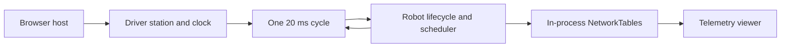

# Wasmbot

Wasmbot is a Gradle plugin and source-bundled runtime that compiles ordinary FRC robot programs to
WebAssembly with [GraalVM Web Image](https://www.graalvm.org/). Robot code written against WPILib
Commands V2, Commands V3, or AdvantageKit is built unmodified: the same `Robot` class, the same
constructors, and the same `robotPeriodic()` lifecycle run on hardware, on a desktop simulation, and
in the browser. There is no separate browser-only simulation lifecycle to maintain.

The published plugin identifier is `org.teamvan.wasmbot`.

## Contents

- [Requirements](#requirements)
- [Installation](#installation)
- [Configuration](#configuration)
- [Robot entry point](#robot-entry-point)
- [Building and running locally](#building-and-running-locally)
- [Publishing the simulator with GitHub Pages](#publishing-the-simulator-with-github-pages)
- [Architecture](#architecture)
- [Supported surface and limitations](#supported-surface-and-limitations)
- [Examples](#examples)
- [Licensing](#licensing)

## Requirements

| Prerequisite               | Version            | Needed for                                          |
| -------------------------- | ------------------ | --------------------------------------------------- |
| GraalVM JDK with Web Image | 25                 | Compiling and linking the WebAssembly image         |
| Gradle                     | 9.4.1              | Building the robot project                          |
| Binaryen                   | `version_133`      | `wasm-opt` and `wasm-as` post-processing             |
| WPILib                     | `2027.0.0-alpha-7` | Robot code, with Commands V2 or Commands V3         |
| JSPI-capable browser       | Current release    | The browser simulator and telemetry viewer          |
| Node.js and Emscripten     | 22 and 4.0.12      | Only when the bundled viewer is rebuilt from source |

The Web Image tool must be present as `native-image --tool:svm-wasm`, and the
`org.graalvm.webimage.api` module must be available. An ordinary Java 25 JDK cannot compile or link
the browser target. The browser must provide `WebAssembly.Suspending` and
`WebAssembly.promising`.

Binaryen is pinned because `wasm-opt` output and option handling vary between releases; the
repository's continuous integration installs the published `version_133` archive rather than a
distribution package, which may lag behind it. Commands V2 and Commands V3 cannot be installed in
the same project.

## Installation

### Toolchain

Install a GraalVM 25 JDK, Binaryen, and your platform's native compiler toolchain. Point
`JAVA_HOME` and `GRAALVM_HOME` at the GraalVM installation, then add its `bin` directory to the
executable search path so `java`, `javac`, and `native-image` resolve to that installation.

The exact commands differ per platform; the following outline is sufficient in each case.

**Windows**

- Install the GraalVM JDK and Binaryen, and install the Visual Studio C++ build tools including the
  x64 workload.
- Build from a developer shell provided by those build tools, so that the compiler environment is
  already initialized.
- Set `JAVA_HOME` and `GRAALVM_HOME` to the GraalVM installation directory, prepend its `bin`
  directory to `PATH`, and confirm that both the host and target architecture reported by the
  environment are `x64`.
- Use `.\gradlew.bat` wherever the commands below show `./gradlew`.

**macOS**

- Install the GraalVM JDK (for example through a version manager or an archive), Xcode command line
  tools, and Binaryen.
- Export `JAVA_HOME` and `GRAALVM_HOME`, and prepend the GraalVM `bin` directory to `PATH`.
- If macOS quarantines a downloaded toolchain, clear the quarantine attribute before use.

**Linux**

- Install the GraalVM JDK archive, a C/C++ toolchain (`gcc` and `g++` or `clang`), `zlib`, and
  Binaryen through your distribution's package manager.
- Export `JAVA_HOME` and `GRAALVM_HOME`, and prepend the GraalVM `bin` directory to `PATH`.

If a platform package manager offers an older Binaryen than the pinned release, install the release
archive instead and add its `bin` directory to the search path.

Verify the toolchain before installing the plugin:

```sh
java -version
native-image --version
native-image --tool:svm-wasm --version
wasm-opt --version
```

The first two commands must report GraalVM 25, and the third must not fail with an unknown-tool
error. A JDK that reports Java 25 but lacks Web Image cannot build the browser target.

### Plugin

**Published artifact (recommended).** WPILib's generated `pluginManagement` block already declares
the Gradle Plugin Portal, so no additional repository is required. Add the plugin to the
`plugins` block of the robot project:

```groovy
plugins {
    id 'org.teamvan.wasmbot' version '0.1.0'
}
```

The implementation artifact is published as `org.teamvan.wasmbot:wasmbot:0.1.0` to the Gradle Plugin
Portal and to Maven Central.

**Included source build.** Place this repository inside the robot project under a relative path and
add it to the existing `pluginManagement` block in `settings.gradle`:

```groovy
includeBuild('wasmbot')
```

Then declare the unversioned identifier in the robot project's `plugins` block:

```groovy
plugins {
    id 'org.teamvan.wasmbot'
}
```

An included build tracks source and resource changes automatically and is convenient while
developing the runtime itself.

For local verification of a release candidate, publish the plugin to the Maven local repository
(`./gradlew check assemble publishToMavenLocal` from this repository) and add `mavenLocal()` before
the plugin portal in the consumer's `pluginManagement.repositories`.

Do not add the runtime as a desktop `implementation` dependency. The plugin attaches it only to the
WebAssembly source sets; desktop and hardware builds keep the ordinary WPILib implementation.

## Configuration

Configure the robot's real entry point and the native artifact name through the `wasmbot`
extension:

```groovy
wasmbot {
    mainClass.set('example.Main')
    imageName.set('robot')
}
```

| Property            | Default  | Meaning                                                                    |
| ------------------- | -------- | -------------------------------------------------------------------------- |
| `mainClass`         | Required | Ordinary entry point calling `RobotBase.startRobot(...)`.                  |
| `imageName`         | `wasm`   | Base name of the generated native artifact, without extensions.            |

The plugin applies the GraalVM native build plugin itself. Remove legacy local adapters, copied
runtime sources, custom native-image definitions, and hand-written loader patches when migrating;
those responsibilities now belong to the plugin.

## Robot entry point

Use the same entry point as any WPILib project:

```java
package example;

import org.wpilib.framework.RobotBase;

public final class Main {
  private Main() {}

  public static void main(String... args) {
    RobotBase.startRobot(Robot::new);
  }
}
```

The robot's constructor performs initialization. Wasmbot constructs the real `Robot` once, invokes
`simulationInit()` once, and then drives the ordinary iterative lifecycle. `robotPeriodic()` runs in
both enabled and disabled cycles, and the application remains responsible for its own scheduler
call, input sampling, and output publication, in the order appropriate for the project:

```java
@Override
public void robotPeriodic() {
  Scheduler.getDefault().run();
  Telemetry.log("Example/Counter", counter.ticks());
}
```

Shared robot code can detect the browser target without importing any Wasmbot class:

```java
boolean runningUnderWasm = Boolean.getBoolean("wasmbot");
```

The `wasmbot` system property is set before the constructor runs and is absent on desktop and
hardware launches.

## Building and running locally

```sh
./gradlew nativeCompile
./gradlew wasmSite advantagescope
```

| Task             | Result                                                                      |
| ---------------- | --------------------------------------------------------------------------- |
| `nativeCompile`  | Produces the WebAssembly image and its generated JavaScript loader.         |
| `wasmSite`       | Stages the browser simulator and the native image as a static site.         |
| `advantagescope` | Stages the bundled AdvantageScope Lite telemetry viewer alongside that site. |

Serve the staged site over HTTP rather than opening it from the filesystem; module loading and
`WebAssembly` instantiation require an origin. Any static file server works. Run it from the staged
site directory, for example:

```sh
python3 -m http.server 8099
```

Then open `http://localhost:8099/` in a JSPI-capable browser.

The simulator panel starts disabled and in the unknown mode. Select **Teleop**, **Auto**, or
**Utility**, choose a published opmode, and then enable the robot. Losing focus or hiding the page
disables the robot and releases held inputs without changing the selected mode. Keyboard bindings,
controller port assignments, deadzone, and axis inversion are configurable from the panel:

| Keyboard       | Gamepad input               |
| -------------- | --------------------------- |
| W/S, A/D       | Left Y, left X              |
| Q/E, R/F       | Right X, right Y            |
| Z/C            | Left and right triggers     |
| J/K/U/I        | Face down/right/left/up     |
| 1/3            | Left and right bumpers      |
| B/Enter, Home  | Back/start, guide           |
| V/N, arrows    | Stick clicks, D-pad         |
| Shift          | Red alliance while held     |

Opmodes are registered in the robot constructor and published once; the panel lists them for the
current mode and falls back to the framework lifecycle when none is selected. Standard browser
gamepads are mapped automatically, and non-standard mappings are reported as unsupported rather
than guessed.

## Publishing the simulator with GitHub Pages

The staged site is a plain static directory, so it can be deployed directly to GitHub Pages. Enable
Pages for the repository, choose **GitHub Actions** as the source, and commit the following workflow
as `.github/workflows/pages.yaml`. It provisions the three build prerequisites — Binaryen, a
GraalVM JDK, and Gradle — with pinned actions, then builds and uploads the staged site:

```yaml
name: pages

on:
  push:
    branches: [main]
  workflow_dispatch:

permissions:
  contents: read
  pages: write
  id-token: write

concurrency:
  group: pages
  cancel-in-progress: true

jobs:
  build:
    runs-on: ubuntu-latest
    steps:
      - name: Check out the repository
        uses: actions/checkout@v7

      - name: Set up Binaryen
        shell: bash
        run: |
          set -euo pipefail
          version="version_133"
          archive="binaryen-${version}-x86_64-linux.tar.gz"
          url="https://github.com/WebAssembly/binaryen/releases/download/${version}/${archive}"
          curl --fail --location --retry 3 --output "${RUNNER_TEMP}/${archive}" "${url}"
          mkdir -p "${RUNNER_TEMP}/binaryen"
          tar --extract --gzip --file "${RUNNER_TEMP}/${archive}" --directory "${RUNNER_TEMP}/binaryen" --strip-components=1
          echo "${RUNNER_TEMP}/binaryen/bin" >> "${GITHUB_PATH}"

      - name: Set up JDK 25
        uses: actions/setup-java@v6
        with:
          distribution: graalvm
          java-version: "25"

      - name: Set up Gradle 9.4.1
        uses: gradle/actions/setup-gradle@v6
        with:
          gradle-version: "9.4.1"

      - name: Build the simulator
        run: gradle --no-daemon wasmSite advantagescope

      - name: Configure Pages
        uses: actions/configure-pages@v5

      - name: Upload Pages artifact
        uses: actions/upload-pages-artifact@v3
        with:
          path: build/wasm/site

  deploy:
    needs: build
    runs-on: ubuntu-latest
    environment:
      name: github-pages
      url: ${{ steps.deployment.outputs.page_url }}
    steps:
      - name: Deploy to GitHub Pages
        id: deployment
        uses: actions/deploy-pages@v4
```

Notes:

- `actions/setup-java` supplies the GraalVM distribution, and `gradle/actions/setup-gradle` supplies
  the pinned Gradle version, so the runner needs no preinstalled toolchain. Confirm that the
  selected GraalVM release includes Web Image by running `native-image --tool:svm-wasm --version`
  once locally; without it, compilation fails as a missing `org.graalvm.webimage.api` type.
- Binaryen is installed from its pinned release archive rather than from the distribution package,
  so `wasm-opt` matches the version the image pipeline was validated against.
- `wasmSite` builds the native image before staging, so a separate `nativeCompile` step is
  unnecessary. The workflow uploads the staged site directory produced by `wasmSite` and
  `advantagescope`; adjust only that upload path if your project stages its site elsewhere.
- A project that consumes Wasmbot through an included source build also compiles the bundled viewer
  and therefore additionally needs Node.js 22 and Emscripten 4.0.12, as this repository's own
  workflow does. A project that consumes the published plugin does not.
- Pin the plugin version in `build.gradle`, so every deployment builds against the same runtime. The
  workflow invokes the Gradle version installed by the setup step; a project that requires its own
  wrapper can substitute `./gradlew` and drop `gradle-version` from that step.

## Architecture

Wasmbot is a source-bundled runtime rather than a fork of WPILib. The plugin packages a small
JavaScript host layer, a set of Java runtime replacements, and the native build configuration. Each
consumer project compiles those runtime sources against its own WPILib and vendor dependencies, so
the runtime always matches the library versions the robot was written for.

The desktop classpath is untouched. A separate WebAssembly compilation isolates the runtime
replacements and keeps them out of the robot JAR; shared robot code observes only the `wasmbot`
system property. When a project supplies its own replacement for a package, that replacement takes
precedence over the bundled one.

In the browser, a thin host layer supplies the services a robot normally obtains from the driver
station and the native HAL: a monotonic clock, driver-station state, controller data, and an
in-process NetworkTables transport. The host advances the image one 20 ms cycle at a time and awaits
each cycle before starting the next. Suspended Java stacks, including command coroutines, are
preserved by the JavaScript Promise Integration mechanism, so blocking-looking command code stays
readable without a browser-specific rewrite.

Telemetry is published through the ordinary NetworkTables API and delivered unchanged to the
bundled viewer and to any AdvantageScope-compatible client attached to the same host. Everything
the runtime and the host exchange is exposed on a single global namespace, which keeps the boundary
explicit and prevents hidden global aliases.



## Supported surface and limitations

- **Robot bases.** `OpModeRobot`, `TimedRobot`, and `IterativeRobotBase` use host-driven, HAL-free
  lifecycles. No native notifier, scheduler thread, or blocking competition loop is started.
- **Timing.** Main-loop periods and `addPeriodic(...)` callbacks use the host clock. Missed
  expirations coalesce instead of replaying a burst; periods shorter than the host interval are
  quantized to it.
- **Commands.** The real WPILib scheduler and command classes remain in use. Continuation-backed
  coroutines preserve suspended stacks, child awaiting, cancellation, and exception identity.
- **NetworkTables.** Default-instance tables, typed and generic publication of primitives and
  arrays, raw and struct data, topic properties, schemas, and double-entry reads are supported.
  Native listeners, subscription queues, additional instances, and network client or server startup
  are not.
- **AdvantageKit.** Live logging is supported when the project already declares the
  `akit-java` vendordep. File-backed recording and replay, native socket receivers, URCL, and
  console capture are rejected explicitly.
- **Hardware.** Native watchdog diagnostics, controller LEDs, touchpads, CAN/FMS integration, and
  other JNI-backed hardware entry points fail explicitly rather than silently succeeding. Vendor
  code paths that require hardware must select their simulated implementation, as they would on a
  desktop simulation.
- **Files.** Files under `src/main/deploy` are staged into the image's in-memory filesystem before
  the robot is constructed and are read through the ordinary `File`, stream, reader, and
  read-side `java.nio.file.Files` APIs. The staging lives for the browser session only; writes are
  discarded when the page unloads.

After upgrading GraalVM, WPILib, or a framework shim, rebuild the image and re-check the staged
page. Incompatible hooks and missing JSPI support surface as errors; Wasmbot does not substitute
fake continuations.

## Examples

Self-contained consumer projects are provided under `examples/`:

| Example        | Demonstrates                                                     |
| -------------- | ---------------------------------------------------------------- |
| `commands-v3`  | Commands V3 with an application-owned scheduler and opmodes.       |
| `commands-v2`  | Commands V2 with `TimedRobot` and a default subsystem command.     |
| `advantagekit` | Live AdvantageKit logging through `NT4Publisher`.                  |
| `drivetrain`   | A port-zero gamepad, simulated drivetrain dynamics, and telemetry. |

Each example is an ordinary WPILib project that consumes the published plugin. From the repository
root:

```sh
./gradlew check assemble publishToMavenLocal
./gradlew -p examples/commands-v3 wasmSite advantagescope
```

## Licensing

Wasmbot is distributed under the MIT License; see [LICENSE](LICENSE).

Retained WPILib-derived code is covered by [WPILib-License.md](WPILib-License.md), and retained
AdvantageKit-derived code by [AdvantageKit-LICENSE](AdvantageKit-LICENSE). Both are included in the
distributed source bundle.

### Project notes

Parts of this project were developed with the assistance of large language models. All generated
output was reviewed and validated in the browser before inclusion.
